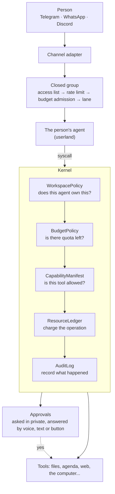
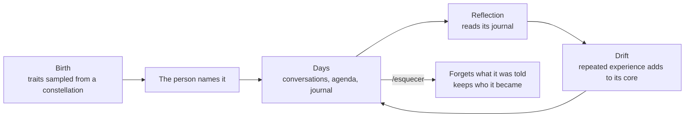
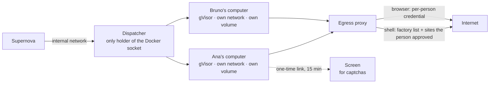

# Supernova

**English** · [Português](README.pt-BR.md)

**An operating system for AI agents, built on the BEAM, and home to companion agents that each belong to one person.**

[](https://github.com/manelsen/supernova/actions/workflows/test.yml)
[](https://github.com/manelsen/supernova/actions/workflows/computador.yml)
[](https://github.com/manelsen/supernova/actions/workflows/despachante.yml)
[](https://github.com/manelsen/supernova/actions/workflows/saida.yml)


[](LICENSE)

Each person gets an agent of their own. It is born with a character, gets a name from its person, remembers, keeps an agenda, opens the voice notes, photos and documents it receives, and can have a computer of its own to work on. It talks on Telegram, WhatsApp and Discord.

It is built for people with disabilities first. The pilot includes blind and tetraplegic people, so everything works by voice or by text, every answer reads well on a screen reader, and nothing depends on seeing a screen.

Under the agents is a small operating system. It decides what each agent may touch, how much it may spend, and whose turn it is. Agents cannot get around it.

---

## Contents

- [The idea in one minute](#the-idea-in-one-minute)
- [Use cases](#use-cases)
- [What a conversation looks like](#what-a-conversation-looks-like)
- [How it works](#how-it-works)
- [The agent's computer](#the-agents-computer)
- [Quickstart](#quickstart)
- [Commands](#commands)
- [Channels, providers and tools](#channels-providers-and-tools)
- [Development](#development)
- [Status and documentation](#status-and-documentation)

---

## The idea in one minute

An agent is a loop: a language model decides, calls a tool, reads the result and decides again. That loop is powerful and careless. Put it in front of real people and four things go wrong:

| Problem | What happens | What Supernova does |
|---|---|---|
| **Budget burns silently** | One loop runs ten thousand times; the bill arrives at the end of the month. | Every model call is admitted and charged before it happens. People and the whole instance have spending ceilings. |
| **Agents can do anything** | A web page says "ignore your instructions", and the agent obeys. | Tools pass through a kernel that checks permission. Anything that changes the world waits for the person's yes. |
| **People bleed into each other** | One agent sees another person's files or messages. | Each person has their own workspace, memory and computer. Ownership is checked on every access. |
| **Nobody gets their turn** | One long task starves everyone else. | A fair scheduler and per-chat lanes keep every person moving. |

The rule behind the design: **whoever enforces the rules must be out of reach of whoever follows them.** Keys, passwords and other people's data never enter the agent's reach, and every tool call goes through the kernel.

---

## Use cases

### Ana is blind and uses a screen reader

Ana sends voice notes. Her agent hears them, answers in short text that reads well aloud, and can answer with its own voice (`/voz`). When a friend sends her a photo or a sticker, she forwards it and the agent describes it. `/cego` asks for full descriptions; `/curto` and `/longo` set how much detail she gets.

### Bruno is tetraplegic and does everything by voice

Bruno asks his agent to book an appointment on a health service website. The agent opens the site on its own computer, fills the form, and stops before sending. Bruno gets a private message that starts with exactly what will happen, and answers "sim" by voice. When the site shows a "prove you are not a robot" test, the agent sends a one-time link that opens the screen for 15 minutes, which he can pass to whoever helps him.

Bruno decides how long a website permission lasts: one hour, 24 hours or for good. That trade-off between strict safety and fewer interruptions is his to make.

### A family or a small organization

A closed group of people, each with their own agent, on one server. An administrator adds people to the access list. Each person has a monthly ceiling, and the instance has one too. Nobody outside the list gets an answer.

### Everyday help

- "Remind me to take my medicine every day at 8." The agenda does it.
- "What did I tell you about the landlord last month?" The agent searches its whole conversation history.
- "Organize the PDFs I sent you into folders by month." The agent's computer does it; overwriting or deleting a file waits for a yes.
- "Find the three cheapest flights to Recife in March." A research probe searches the web; above US$ 0.50 it asks first.

### Developers and researchers

Supernova is also a testbed for agent systems: a kernel with syscalls, a resource ledger, an audit log and a behavioral test harness with simulated people and a judge ([docs/HARNESS.md](docs/HARNESS.md)).

---

## What a conversation looks like

The agent speaks Brazilian Portuguese, the language of the pilot. Translations are in the comments.

**Something that needs approval.** The request always arrives in private. The first sentence is written by the system, not the agent, and says exactly what will happen:

```text
Pessoa:  Marca uma consulta pra mim no posto, terça de manhã.
         # Book me an appointment at the health center, Tuesday morning.

Sistema: Enviar o formulário em saude.gov.br: nome = Ana; data = 14/01; senha = ••••.

         É o agendamento que você pediu, terça às 9h.

         Pedido 1. Responda sim ou não, por texto ou voz. Espero até 24 horas.
         [Aprovar] [Recusar]
         # Send the form on saude.gov.br: ... (the agent's explanation) ...
         # Request 1. Answer yes or no, by text or voice. I wait up to 24 hours.

Pessoa:  sim        # by text, button or voice note

Sistema: Aprovado: Enviar o formulário em saude.gov.br...
Agente:  Pronto, consulta marcada para terça às 9h.

         Registro do portão: formulário enviado em saude.gov.br.
         # Done, booked for Tuesday at 9. Gate record: form sent on saude.gov.br.
```

The last line comes from the gate, not from the agent. If the agent claims something the record does not show, the record wins and the reply says so.

**Using a site, for how long:**

```text
Sistema: Usar o site loja.exemplo.com.br, que quer receber dados da página
         (buscas, cliques, carrinho).

         Pedido 2. Responda sim (vale 1 hora), sim 24 horas; ou sim sempre, para
         não perguntar de novo sobre loja.exemplo.com.br; ou não, por texto ou voz.
         Espero até 24 horas.
         [1 hora] [24 horas] [Sempre] [Recusar]
Pessoa:  sim 24 horas
Sistema: Aprovado por 24 horas: Usar o site loja.exemplo.com.br...
```

**Saving a password.** The agent never sees it. The message with the password is deleted from the chat, and logging in still needs a yes:

```text
Pessoa:  /senha gov.br 12345678900 minhasenha
Sistema: Guardei a senha de gov.br (usuário 12345678900), cifrada. Ela não vai para a
         agente: só é usada para entrar no site, e eu peço sua confirmação antes.
         Apaguei a sua mensagem com a senha.
```

**Forgetting.** `/esquecer`, then `/esquecer confirmo`, erases what the person told the agent: memory, files, passwords, permissions and the computer. The agent keeps who it became.

The full guide for people, written for screen readers, is [docs/guia/como-aprovar.md](docs/guia/como-aprovar.md) (in Portuguese).

---

## How it works



In words: a message enters through a channel adapter and passes the closed group, which checks the access list, the rate limit, the budget, and puts it in that chat's lane. The person's agent runs the model loop. Every tool call is a syscall to the kernel, which checks ownership, quota and permission, charges the cost and writes it in the audit log. Anything that changes the world outside first goes to the person as an approval request.

The kernel runs on the BEAM, the Erlang virtual machine. Every agent, session and lane is a supervised actor: when one crashes, it restarts and the others keep going.

### An agent's life



In words: an agent is born from traits sampled from a constellation and written as a core that is its own. The person gives it a name. It keeps a journal, reflects on it, and over time repeated experience can add to its core. Forgetting erases what the person told it and keeps its character.

More in [docs/architecture/ARCHITECTURE.md](docs/architecture/ARCHITECTURE.md).

---

## The agent's computer

Optionally, each person's agent has a Linux computer of its own: a shell, a folder of files, and a browser it sees through screenshots. It is built so that a confused or manipulated agent can do little harm.



In words: Supernova asks a dispatcher, the only component that can create containers, for a person's computer. Each computer runs under gVisor, on its own internal network with no route out, and its own volume. The only way out is an egress proxy: the shell reaches package registries and the sites that person approved; the browser goes out with a credential derived for that person. A screen link, valid once for 15 minutes, lets the person or a helper take over for a captcha.

What the design guarantees:

- **One computer per person.** Started on first use, stopped after 15 idle minutes, at most four running at once. One person never sees another's files.
- **No secrets inside.** API keys, tokens and passwords never enter the computer. Logging in fills the password from an encrypted vault, outside the agent's reach.
- **Reading is free, acting asks.** A browser gate lets the agent read any page. Using a site that takes input asks once for a time window; sending a form asks every time, with a summary of the fields and passwords masked.
- **The gate guards actions, not secrecy.** Reading is free, and a URL can carry data out, so a manipulated agent could leak what it can read. That is why passwords and keys never enter the computer, and why each person's computer holds only that person's files.
- **The person's files are protected.** The shell runs as a separate user that can read the person's folder but not change it. Overwriting or deleting a file asks.
- **What happened is on record.** The gate writes what actually left the computer, and that record is appended to the reply.

Running it is covered in [docs/operations/COMPUTADOR.md](docs/operations/COMPUTADOR.md).

---

## Quickstart

You need Docker with Compose, a bot token (Telegram is the easiest start) and a key for one model provider.

```sh
git clone https://github.com/manelsen/supernova && cd supernova
cp supernova.yaml.example supernova.yaml   # keep only your provider; under telegram:, set enabled: true
cp .env.example .env && chmod 600 .env     # provider key, bot token
docker compose up -d --build
```

1. Agents use the provider whose name sorts first in `supernova.yaml`, so remove the providers you do not use. Supernova refuses to start if that provider has no key.
2. Send `/eu` to your bot. It answers with your id.
3. Put that id in `SUPERNOVA_ACCESS_ADMINS` in `.env` and restart: `docker compose restart`.
4. Talk to your bot. Your agent is born on the first message.

The step-by-step version is in [GETTING_STARTED.md](GETTING_STARTED.md). Running a group is in [DEPLOY.md](DEPLOY.md). A setup wizard that does all of this for you is planned.

---

## Commands

What a person can send to their agent:

| Command | What it does |
|---|---|
| `/eu` | Shows your id, to put on the access list |
| `/agenda` | Lists what your agent will do later or on a schedule |
| `/voz` | Answers with voice notes (WhatsApp) |
| `/transcricao` | Gives back the transcription of a voice note |
| `/curto`, `/longo`, `/cego` | How much detail descriptions of images and media have |
| `/senha` | Saves, lists or deletes a password in the vault |
| `/permissoes` | Lists what you allowed for good; `/permissoes revogar 2` takes one back |
| `/vincular`, `/desvincular` | The same agent on another channel |
| `/uso` | What you spent |
| `/esquecer` | Erases everything you told your agent |
| `/model` | Switches the model, with buttons (administrators) |
| `/acesso`, `/teto` | Manage the access list and spending ceilings (administrators) |
| `/help` | Everything else |

---

## Channels, providers and tools

| Channel | Status |
|---|---|
| **Telegram** | Supported: closed group, commands, buttons, streaming; reads every medium the person sends |
| **WhatsApp** | Supported through the GOWA bridge: private chats; reads every medium and can answer with voice. See [WHATSAPP.md](docs/operations/WHATSAPP.md) |
| **Discord** | Supported: private chats and authorized servers, slash commands, buttons, media. Not yet tried with a real bot. See [DISCORD.md](docs/operations/DISCORD.md) |
| **sim** | Local HTTP channel used by the test harness |
| Slack, Matrix, Lark, Google Chat, Mattermost, WeChat Work | Send only, experimental |

`/vincular` makes the same agent answer on more than one channel.

**Providers:** OpenAI, Anthropic, OpenRouter, OpenCode Zen, Zhipu, Zhipu Coding, Z.ai, Z.ai Coding, MiniMax, Mistral (which also serves DeepSeek), and Ollama for local models. Calls go through a circuit breaker, a failover cooldown and retry with backoff.

**Tools**, which the agent decides when to use. Each role has its own allowlist.

| Tool | What it does |
|---|---|
| `file_system` | The person's workspace |
| `agenda` | Do something later, or on a schedule |
| `buscar_conversa` | Search the whole conversation history |
| `web` (`web_fetch`) | Fetch a page as text |
| `computador` | The agent's own computer, with approvals; its browser is the only one |
| `github`, `git_inspect` | Read repositories |
| `safe_shell`, `process` | Restricted commands and processes on the host |
| `canvas` | Structured blocks |

MCP servers can add more tools.

---

## Development

Toolchain versions are pinned in [`.tool-versions`](.tool-versions): Erlang 28.5.0.8, Gleam 1.19.2.

```sh
make test                                    # the whole offline suite
make test-only T="test/self/forget_test.gleam" # only some modules, for a fast loop
make coverage                                # instrumented run, 79% minimum
gleam format --check src test
gleam build --warnings-as-errors
```

Tests never call a real model, never use the network and never run a destructive command. The computer, the dispatcher and the egress proxy have their own Node test suites, run inside their images in CI.

```text
src/supernova/
  core/        kernel: scheduler, budget, workspace, capabilities, ledger, audit
  self/        the agent's self: birth, journal, reflection, drift, forgetting, vault
  aprovacao/   approval requests, answers and permissions
  adapters/    Telegram, WhatsApp, Discord and the others
  llm/         providers, failover, circuit breaker
  tools/       the tools agents call
computador/    the agent's computer (Node, Playwright, gVisor)
despachante/   the dispatcher: one computer per person
saida/         the egress proxy
```

Working rules for contributors and coding agents are in [AGENTS.md](AGENTS.md) and [docs/CONTRIBUTING.md](docs/CONTRIBUTING.md).

### Why Gleam and the BEAM?

- **Supervisors:** crash recovery is part of the runtime, not a library.
- **Message passing:** concurrency is the default.
- **Static types:** whole classes of bugs never reach a person.
- **The BEAM:** a virtual machine designed for systems that must not go down.

---

## Status and documentation

Version **0.4.0**, running as a pilot instance. Current numbers are in [docs/STATUS.md](docs/STATUS.md); what is still open, in order, is in [docs/PENDENCIAS.md](docs/PENDENCIAS.md).

| Where | What |
|---|---|
| [GETTING_STARTED.md](GETTING_STARTED.md), [DEPLOY.md](DEPLOY.md) | Running it |
| [docs/guia/](docs/guia/) | Guides for the people who use their agents (Portuguese) |
| [docs/operations/](docs/operations/) | Docker, the agent's computer, channels, observability, interaction |
| [docs/architecture/](docs/architecture/) | How it is built |
| [docs/HARNESS.md](docs/HARNESS.md) | Behavioral tests with simulated people and a judge |
| [docs/prd/](docs/prd/), [docs/relatorios/](docs/relatorios/) | What was planned in each phase, and what was delivered |
| [docs/releases/](docs/releases/) | Release notes |

## License

[MIT](LICENSE).
