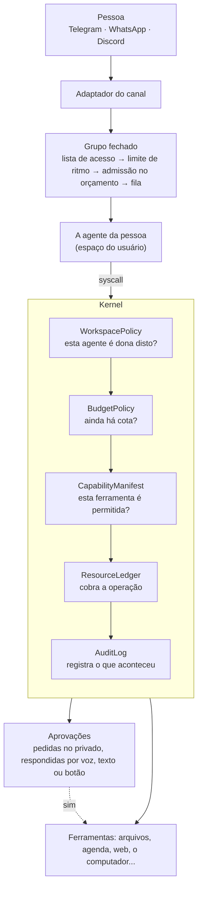
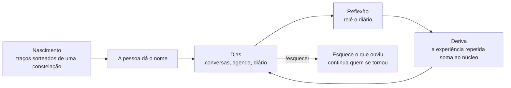
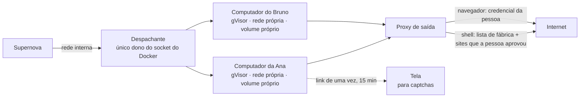

# Supernova

[English](README.md) · **Português**

**Um sistema operacional para agentes de IA, feito sobre a BEAM, e a casa de agentes companheiras que pertencem, cada uma, a uma pessoa.**

[](https://github.com/manelsen/supernova/actions/workflows/test.yml)
[](https://github.com/manelsen/supernova/actions/workflows/computador.yml)
[](https://github.com/manelsen/supernova/actions/workflows/despachante.yml)
[](https://github.com/manelsen/supernova/actions/workflows/saida.yml)


[](LICENSE)

Cada pessoa ganha uma agente só sua. Ela nasce com um caráter, recebe um nome da sua pessoa, lembra, mantém uma agenda, abre os áudios, fotos e documentos que recebe e pode ter um computador próprio para trabalhar. Ela conversa pelo Telegram, pelo WhatsApp e pelo Discord.

Ela é feita primeiro para pessoas com deficiência. O piloto inclui pessoas cegas e tetraplégicas: tudo funciona por voz ou por texto, toda resposta soa bem num leitor de tela e nada depende de enxergar uma tela.

Por baixo das agentes há um pequeno sistema operacional. Ele decide o que cada agente pode tocar, quanto pode gastar e de quem é a vez. As agentes não conseguem contorná-lo.

---

## Sumário

- [A ideia em um minuto](#a-ideia-em-um-minuto)
- [Casos de uso](#casos-de-uso)
- [Como é uma conversa](#como-é-uma-conversa)
- [Como funciona](#como-funciona)
- [O computador da agente](#o-computador-da-agente)
- [Começo rápido](#começo-rápido)
- [Comandos](#comandos)
- [Canais, provedores e ferramentas](#canais-provedores-e-ferramentas)
- [Desenvolvimento](#desenvolvimento)
- [Estado e documentação](#estado-e-documentação)

---

## A ideia em um minuto

Um agente é um laço: um modelo de linguagem decide, chama uma ferramenta, lê o resultado e decide de novo. Esse laço é poderoso e descuidado. Coloque-o na frente de pessoas reais e quatro coisas dão errado:

| Problema | O que acontece | O que a Supernova faz |
|---|---|---|
| **O orçamento queima em silêncio** | Um laço roda dez mil vezes; a conta chega no fim do mês. | Toda chamada ao modelo é admitida e cobrada antes de acontecer. Cada pessoa e a instância inteira têm teto de gasto. |
| **O agente pode fazer qualquer coisa** | Uma página diz "ignore suas instruções", e o agente obedece. | As ferramentas passam por um kernel que confere a permissão. Tudo o que muda o mundo espera o sim da pessoa. |
| **As pessoas vazam umas nas outras** | Um agente vê os arquivos ou as mensagens de outra pessoa. | Cada pessoa tem o seu espaço de trabalho, a sua memória e o seu computador. A posse é conferida em todo acesso. |
| **Ninguém tem a sua vez** | Uma tarefa longa deixa todo mundo esperando. | Um escalonador justo e uma fila por conversa fazem todo mundo andar. |

A regra por trás do desenho: **quem aplica as regras precisa estar fora do alcance de quem as segue.** Chaves, senhas e dados de outras pessoas nunca ficam ao alcance da agente, e toda chamada de ferramenta passa pelo kernel.

---

## Casos de uso

### Ana é cega e usa leitor de tela

Ana manda áudios. A agente dela ouve, responde em textos curtos que soam bem em voz alta e pode responder com a própria voz (`/voz`). Quando uma amiga manda uma foto ou uma figurinha, Ana encaminha e a agente descreve. `/cego` pede descrições completas; `/curto` e `/longo` ajustam o quanto de detalhe ela recebe.

### Bruno é tetraplégico e faz tudo por voz

Bruno pede à agente que marque uma consulta no site de um serviço de saúde. A agente abre o site no computador dela, preenche o formulário e para antes de enviar. Bruno recebe uma mensagem no privado que começa dizendo exatamente o que vai acontecer, e responde "sim" por voz. Quando o site mostra um teste de "prove que você não é um robô", a agente manda um link que vale uma vez e abre a tela por 15 minutos. Bruno pode passar o link para quem o ajuda.

Bruno decide quanto tempo vale a liberação de um site: uma hora, 24 horas ou para sempre. Esse equilíbrio entre segurança estrita e menos interrupções é dele.

### Uma família ou uma organização pequena

Um grupo fechado de pessoas, cada uma com a sua agente, num servidor só. Quem administra põe as pessoas na lista de acesso. Cada pessoa tem um teto mensal, e a instância também. Quem está fora da lista não recebe resposta.

### Ajuda do dia a dia

- "Me lembra de tomar o remédio todo dia às 8." A agenda faz isso.
- "O que eu te contei sobre o proprietário mês passado?" A agente busca no histórico inteiro da conversa.
- "Organiza os PDFs que te mandei em pastas por mês." O computador da agente faz isso; sobrescrever ou apagar um arquivo espera um sim.
- "Acha as três passagens mais baratas para Recife em março." Uma sonda de pesquisa busca na web; acima de US$ 0,50, ela pergunta antes.

### Desenvolvimento e pesquisa

A Supernova também é uma bancada para sistemas de agentes: um kernel com syscalls, um livro-razão de recursos, um registro de auditoria e um harness de testes de comportamento com pessoas simuladas e um juiz ([docs/HARNESS.md](docs/HARNESS.md)).

---

## Como é uma conversa

**Algo que precisa de aprovação.** O pedido chega sempre no privado. A primeira frase é escrita pelo sistema, não pela agente, e diz exatamente o que vai acontecer:

```text
Pessoa:  Marca uma consulta pra mim no posto, terça de manhã.

Sistema: Enviar o formulário em saude.gov.br: nome = Ana; data = 14/01; senha = ••••.

         É o agendamento que você pediu, terça às 9h.

         Pedido 1. Responda sim ou não, por texto ou voz. Espero até 24 horas.
         [Aprovar] [Recusar]

Pessoa:  sim        # por texto, botão ou áudio

Sistema: Aprovado: Enviar o formulário em saude.gov.br...
Agente:  Pronto, consulta marcada para terça às 9h.

         Registro do portão: formulário enviado em saude.gov.br.
```

A última linha vem do portão, não da agente. Se a agente disser algo que o registro não mostra, vale o registro, e a resposta diz isso.

**Usar um site, e por quanto tempo:**

```text
Sistema: Usar o site loja.exemplo.com.br, que quer receber dados da página
         (buscas, cliques, carrinho).

         Pedido 2. Responda sim (vale 1 hora), sim 24 horas; ou sim sempre, para
         não perguntar de novo sobre loja.exemplo.com.br; ou não, por texto ou voz.
         Espero até 24 horas.
         [1 hora] [24 horas] [Sempre] [Recusar]
Pessoa:  sim 24 horas
Sistema: Aprovado por 24 horas: Usar o site loja.exemplo.com.br...
```

**Guardar uma senha.** A agente nunca a vê. A mensagem com a senha é apagada da conversa, e entrar no site ainda precisa de um sim:

```text
Pessoa:  /senha gov.br 12345678900 minhasenha
Sistema: Guardei a senha de gov.br (usuário 12345678900), cifrada. Ela não vai para a
         agente: só é usada para entrar no site, e eu peço sua confirmação antes.
         Apaguei a sua mensagem com a senha.
```

**Esquecer.** `/esquecer` e depois `/esquecer confirmo` apagam o que a pessoa contou à agente: memória, arquivos, senhas, permissões e o computador. A agente continua sendo quem ela se tornou.

O guia completo para as pessoas, escrito para leitores de tela, está em [docs/guia/como-aprovar.md](docs/guia/como-aprovar.md).

---

## Como funciona



Em palavras: uma mensagem entra por um adaptador de canal e passa pelo grupo fechado, que confere a lista de acesso, o limite de ritmo e o orçamento, e a põe na fila daquela conversa. A agente da pessoa roda o laço do modelo. Toda chamada de ferramenta é uma syscall ao kernel, que confere posse, cota e permissão, cobra o custo e escreve no registro de auditoria. Tudo o que muda o mundo lá fora vai antes para a pessoa, como pedido de aprovação.

O kernel roda na BEAM, a máquina virtual do Erlang. Cada agente, sessão e fila é um ator supervisionado: quando um cai, ele volta sozinho e os outros seguem.

### A vida de uma agente



Em palavras: uma agente nasce de traços sorteados de uma constelação, escritos como um núcleo que é só dela. A pessoa dá o nome. Ela mantém um diário, reflete sobre ele e, com o tempo, a experiência repetida pode somar ao seu núcleo. Esquecer apaga o que a pessoa contou e mantém o caráter.

Mais em [docs/architecture/ARCHITECTURE.md](docs/architecture/ARCHITECTURE.md).

---

## O computador da agente

Se a instalação quiser, a agente de cada pessoa tem um computador Linux só seu: um shell, uma pasta de arquivos e um navegador que ela vê por capturas de tela. Ele é feito para que uma agente confusa ou manipulada consiga fazer pouco estrago.



Em palavras: a Supernova pede o computador de uma pessoa a um despachante, o único componente que pode criar contêineres. Cada computador roda sob gVisor, numa rede interna própria sem rota para fora, com um volume próprio. A única saída é um proxy: o shell alcança os repositórios de pacotes e os sites que aquela pessoa aprovou; o navegador sai com uma credencial derivada para aquela pessoa. Um link de tela, que vale uma vez por 15 minutos, deixa a pessoa ou quem a ajuda assumir a tela num captcha.

O que o desenho garante:

- **Um computador por pessoa.** Liga no primeiro uso, desliga depois de 15 minutos parado, no máximo quatro ligados ao mesmo tempo. Uma pessoa nunca vê os arquivos de outra.
- **Nenhum segredo lá dentro.** Chaves de API, tokens e senhas nunca entram no computador. Para entrar num site, a senha vem de um cofre cifrado, fora do alcance da agente.
- **Ler é livre; agir pergunta.** Um portão no navegador deixa a agente ler qualquer página. Usar um site que recebe dados pede uma vez, por um prazo; enviar um formulário pede toda vez, com um resumo dos campos e as senhas mascaradas.
- **O portão guarda ações, não sigilo.** Ler é livre, e um endereço pode levar dados para fora, então uma agente manipulada poderia vazar o que consegue ler. Por isso senhas e chaves nunca entram no computador, e o computador de cada pessoa só tem os arquivos dela.
- **Os arquivos da pessoa ficam protegidos.** O shell roda como outro usuário, que lê a pasta da pessoa mas não a altera. Sobrescrever ou apagar um arquivo pergunta.
- **O que aconteceu fica registrado.** O portão anota o que de fato saiu do computador, e esse registro vai no fim da resposta.

Como pôr para rodar está em [docs/operations/COMPUTADOR.md](docs/operations/COMPUTADOR.md).

---

## Começo rápido

Você precisa de Docker com Compose, do token de um bot (o Telegram é o começo mais fácil) e da chave de um provedor de modelo.

```sh
git clone https://github.com/manelsen/supernova && cd supernova
cp supernova.yaml.example supernova.yaml   # deixe só o seu provedor; em telegram:, ponha enabled: true
cp .env.example .env && chmod 600 .env     # chave do provedor, token do bot
docker compose up -d --build
```

1. As agentes usam o provedor cujo nome vem primeiro em ordem alfabética no `supernova.yaml`, então apague os provedores que você não usa. A Supernova não sobe se esse provedor estiver sem chave.
2. Mande `/eu` para o seu bot. Ele responde com o seu id.
3. Ponha esse id em `SUPERNOVA_ACCESS_ADMINS` no `.env` e reinicie: `docker compose restart`.
4. Converse com o seu bot. A sua agente nasce na primeira mensagem.

O passo a passo completo está em [GETTING_STARTED.md](GETTING_STARTED.md). Para rodar para um grupo, veja [DEPLOY.md](DEPLOY.md). Um assistente que faz tudo isso por você está planejado.

---

## Comandos

O que uma pessoa pode mandar para a sua agente:

| Comando | O que faz |
|---|---|
| `/eu` | Mostra o seu id, para pôr na lista de acesso |
| `/agenda` | Lista o que a sua agente vai fazer depois ou com hora marcada |
| `/voz` | Responde com áudios (WhatsApp) |
| `/transcricao` | Devolve a transcrição de um áudio |
| `/curto`, `/longo`, `/cego` | Quanto detalhe têm as descrições de imagens e mídias |
| `/senha` | Guarda, lista ou apaga uma senha no cofre |
| `/permissoes` | Lista o que você liberou para sempre; `/permissoes revogar 2` tira uma |
| `/vincular`, `/desvincular` | A mesma agente em outro canal |
| `/uso` | Quanto você gastou |
| `/esquecer` | Apaga tudo o que você contou à sua agente |
| `/model` | Troca o modelo, com botões (administração) |
| `/acesso`, `/teto` | Cuida da lista de acesso e dos tetos de gasto (administração) |
| `/help` | Todo o resto |

---

## Canais, provedores e ferramentas

| Canal | Estado |
|---|---|
| **Telegram** | Suportado: grupo fechado, comandos, botões, streaming; lê toda mídia que a pessoa manda |
| **WhatsApp** | Suportado pela ponte GOWA: conversas privadas; lê toda mídia e pode responder com voz. Veja [WHATSAPP.md](docs/operations/WHATSAPP.md) |
| **Discord** | Suportado: conversas privadas e servidores autorizados, comandos de barra, botões, mídia. Ainda não testado com um bot real. Veja [DISCORD.md](docs/operations/DISCORD.md) |
| **sim** | Canal HTTP local usado pelo harness de testes |
| Slack, Matrix, Lark, Google Chat, Mattermost, WeChat Work | Só enviam, experimentais |

`/vincular` faz a mesma agente responder em mais de um canal.

**Provedores:** OpenAI, Anthropic, OpenRouter, OpenCode Zen, Zhipu, Zhipu Coding, Z.ai, Z.ai Coding, MiniMax, Mistral (que também serve o DeepSeek) e Ollama para modelos locais. As chamadas passam por um disjuntor, um intervalo de troca de provedor e novas tentativas com espera crescente.

**Ferramentas**, que a agente decide quando usar. Cada papel tem a sua lista de permitidas.

| Ferramenta | O que faz |
|---|---|
| `file_system` | O espaço de trabalho da pessoa |
| `agenda` | Fazer algo depois, ou com hora marcada |
| `buscar_conversa` | Buscar no histórico inteiro da conversa |
| `web` (`web_fetch`) | Ler uma página como texto |
| `computador` | O computador próprio da agente, com aprovações; o único navegador é o dele |
| `github`, `git_inspect` | Ler repositórios |
| `safe_shell`, `process` | Comandos restritos e processos no servidor |
| `canvas` | Blocos estruturados |

Servidores MCP podem somar mais ferramentas.

---

## Desenvolvimento

As versões das ferramentas estão fixadas em [`.tool-versions`](.tool-versions): Erlang 28.5.0.8, Gleam 1.19.2.

```sh
make test                                      # a suíte inteira, offline
make test-only T="test/self/forget_test.gleam" # só alguns módulos, para um ciclo rápido
make coverage                                  # rodada instrumentada, mínimo de 79%
gleam format --check src test
gleam build --warnings-as-errors
```

Os testes nunca chamam um modelo real, nunca usam a rede e nunca rodam um comando destrutivo. O computador, o despachante e o proxy de saída têm as suas próprias suítes em Node, que rodam dentro das imagens no CI.

```text
src/supernova/
  core/        kernel: escalonador, orçamento, espaço de trabalho, permissões, livro-razão, auditoria
  self/        o eu da agente: nascimento, diário, reflexão, deriva, esquecimento, cofre
  aprovacao/   pedidos de aprovação, respostas e permissões
  adapters/    Telegram, WhatsApp, Discord e os outros
  llm/         provedores, troca de provedor, disjuntor
  tools/       as ferramentas que as agentes chamam
computador/    o computador da agente (Node, Playwright, gVisor)
despachante/   o despachante: um computador por pessoa
saida/         o proxy de saída
```

As regras de trabalho para quem contribui e para agentes de código estão em [AGENTS.md](AGENTS.md) e [docs/CONTRIBUTING.md](docs/CONTRIBUTING.md).

### Por que Gleam e a BEAM?

- **Supervisores:** recuperar de uma queda faz parte do ambiente, não de uma biblioteca.
- **Troca de mensagens:** concorrência é o padrão.
- **Tipos estáticos:** classes inteiras de erros nunca chegam a uma pessoa.
- **A BEAM:** uma máquina virtual feita para sistemas que não podem cair.

---

## Estado e documentação

Versão **0.4.0**, rodando como instância piloto. Os números atuais estão em [docs/STATUS.md](docs/STATUS.md); o que ainda está aberto, em ordem, está em [docs/PENDENCIAS.md](docs/PENDENCIAS.md). A maior parte da documentação técnica está em inglês.

| Onde | O quê |
|---|---|
| [GETTING_STARTED.md](GETTING_STARTED.md), [DEPLOY.md](DEPLOY.md) | Como pôr para rodar |
| [docs/guia/](docs/guia/) | Guias para as pessoas que usam as suas agentes |
| [docs/operations/](docs/operations/) | Docker, o computador da agente, canais, observabilidade, interação |
| [docs/architecture/](docs/architecture/) | Como é construída |
| [docs/HARNESS.md](docs/HARNESS.md) | Testes de comportamento com pessoas simuladas e um juiz |
| [docs/prd/](docs/prd/), [docs/relatorios/](docs/relatorios/) | O que foi planejado em cada fase, e o que foi entregue |
| [docs/releases/](docs/releases/) | Notas de versão |

## Licença

[MIT](LICENSE).
